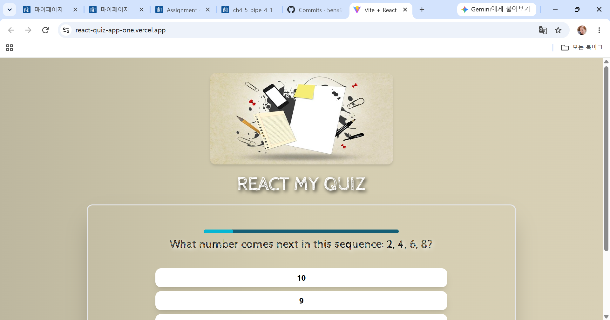

# README.md & Weekly Review
## 1. Project Information
- **프로젝트 명**: React Quiz App (Customized)
- **원본 오픈소스 프로젝트**: [JoniTanh/React-Quiz-App](https://github.com/JoniTanh/React-Quiz-App)
- **원작자 (Copyright)**: Copyright (c) Joni Tanhuansuu
- **라이선스 (License)**: MIT License
- **프로젝트 소개**: React, Vite, Tailwind CSS 기반의 퀴즈 게임 웹 애플리케이션
- **선택 이유**: React 컴포넌트 구조와 타이머 동작 원리를 분석하고 커스텀하기에 좋을 것 같아 선택함.

## 2. Installation: 설치·실행 방법 및 실행 화면
- **설치**: git clone https://github.com/5ena9/React-Quiz-App
- **실행**: 
- **실행 방법**: cd React-Quiz-App/frontend
                 npm install
                 npm run dev

## 3. Source Code Exploration: 주요 파일, 컴포넌트, 코드 분석
- **주요 파일**: src/components/Header.jsx 
                 src/components/Question.jsx
                 src/components/QuestionTimer.jsx
- **컴포넌트**: Header
                Question
- **코드 분석**:

  let timer = 20000;

  if (answer.selectedAnswer) {
    timer = 1000;
  }

  if (answer.isCorrect != null) {
    timer = 2000;
  }

  function handleSelectAnswer(answer) {
    setAnswer({
      selectedAnswer: answer,
      isCorrect: null,
    });

    setTimeout(() => {
      setAnswer({
        selectedAnswer: answer,
        isCorrect: QUESTIONS[index].answers[0] === answer,
      });

      setTimeout(() => {
        onSelectAnswer(answer);
      }, 2000);
    }, 1000);
  }

## 4. Customizing: 수정한 3가지 내용, 수정 파일명 및 전/후 결과
- **수정한 3가지 내용**:
Text - Header를 React Quiz에서 React My Quiz로 수정
Timer - 10000ms 기다리고 넘어가는 빠른 템포를 20000ms(20s) 기다리고 넘어가게끔 수정
Style - 베이지 계열 배경을 연한 하늘색 계열로 수정

## 5. Deployment: 실제 접근 가능한 Vercel URL
- **Vercel URL**: https://react-quiz-app-one.vercel.app

## Weekly Review:
- **새롭게 배운 내용 3가지**: className을 쓰는 걸 직접 볼 수 있었다. React 컴포넌트 사이에서 import로 주고 받는 데이터을 볼 수 있었다. useEffect와 setInterval을 이용한 타이머 제어 및 메모리 누수 방지(Cleanup 함수) 개념을 배웠다.
- **어려웠던 점과 해결 방법**: components가 많이 나눠져있는데 내가 수정하고 싶은 파트의 코드를 찾는 게 생각보다 빨리 되지 않아서 어렵게 느껴졌다. 해결 방법은 그냥 Ctrl+F로 파일마다 검색 기능을 활용해서 찾았다. 그리고 퀴즈 들어갔을 때부터 계속 보이는 배경의 색도 바꾸고 싶었는데, 찾지를 못했다.

- **AI 활용 내용 및 느낀 점**: Gemini 활용을 통해 배경색을 찾아보려고 했는데, 내가 이미 하늘색으로 바꾼 게 배경이 맞다고 해서 AI는 왜 못 찾지?라는 생각을 했다. 깃 로그를 assign10-c02-22500454 레포에 남겼어야 됐는데, React-Quiz-App에 남겨버려서 옮기는 방법을 AI를 활용해 찾았다.